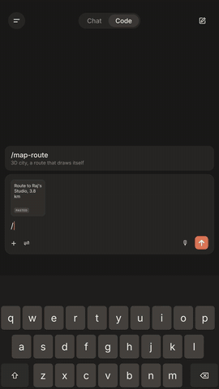
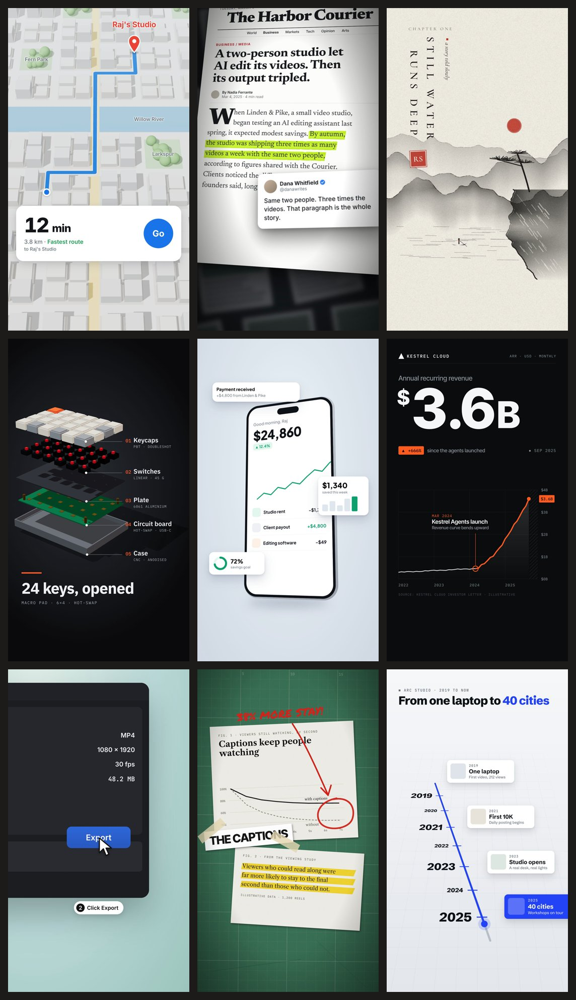
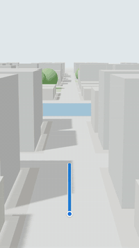
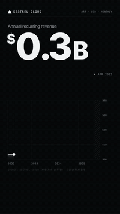
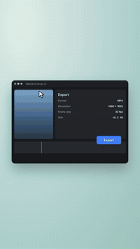
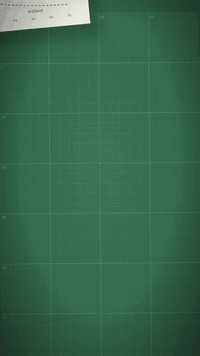
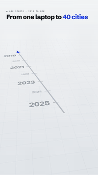

# 9 Animation Styles for Claude

Type a slash command like `/map-route` or `/stat-chart` with your own words, and Claude builds a 5-second 9:16 motion graphic for your reel. It renders it to MP4 and can cut it straight into your own video.

Made and shared by **Raj** · [Instagram @rajshaikh.ai](https://instagram.com/rajshaikh.ai) · [GitHub](https://github.com/rajshaikh-ai) 🎬

Style recipes by **Shaan Johari** ([@viashaan](https://instagram.com/viashaan)) 💛

> Came here from my reel after commenting ANIMATE? Install below, open Claude Code and type `/animate`. Have fun!

## My reel

Every animation in this reel was built by Claude with these commands. Click the GIF to watch it with sound.

<p align="center">
  <a href="assets/demo.mp4"></a>
</p>

More edits like this on my Instagram: **[@rajshaikh.ai](https://instagram.com/rajshaikh.ai)**

## All 9 styles



<table>
  <tr>
    <td align="center"><br><code>/map-route</code></td>
    <td align="center"><br><code>/headline</code></td>
    <td align="center"><br><code>/ink-wash</code></td>
  </tr>
  <tr>
    <td align="center"><br><code>/teardown</code></td>
    <td align="center"><br><code>/app-mockup</code></td>
    <td align="center"><br><code>/stat-chart</code></td>
  </tr>
  <tr>
    <td align="center"><br><code>/screen-zoom</code></td>
    <td align="center"><br><code>/paper-desk</code></td>
    <td align="center"><br><code>/timeline</code></td>
  </tr>
</table>

## Install

**Option 1: inside Claude Code (easiest).** Paste these two lines into Claude Code, one at a time:

```
/plugin marketplace add rajshaikh-ai/claude-animation-styles
/plugin install animation-styles@rajshaikh-ai
```

**Option 2: one line in the Terminal.** Open the Terminal app (or the terminal inside Claude Code) and paste:

```bash
git clone https://github.com/rajshaikh-ai/claude-animation-styles ~/claude-animation-styles && mkdir -p ~/.claude/skills && cp -R ~/claude-animation-styles/skills/* ~/.claude/skills/
```

On Windows (PowerShell):

```powershell
git clone https://github.com/rajshaikh-ai/claude-animation-styles $HOME\claude-animation-styles; New-Item -ItemType Directory -Force $HOME\.claude\skills | Out-Null; Copy-Item -Recurse $HOME\claude-animation-styles\skills\* $HOME\.claude\skills\
```

Then restart Claude Code. That's it.

> Not sure how? Open Claude Code and paste: **"Install the animation styles from github.com/rajshaikh-ai/claude-animation-styles"**. Claude will do it for you.

## Use it

1. Open Claude Code (the app or the terminal).
2. Type `/animate` to see the menu, or go straight to a style with your own words:

```
/map-route Tip Top Cafe, 12 min, 3.4 km
/stat-chart 0 to 25K followers in 6 months, event: first viral reel
/headline my news story about AI editing, highlight the line about output tripling
/ink-wash title card for my Japan travel vlog
/teardown what's inside my mechanical keyboard
```

3. Want it inside your own video? Drag your video into the chat and say where: *"put it in at 4 seconds"*, *"as a card over me"*, or *"at the start"*. Your audio stays as it was.

The first time, Claude sets up a small Remotion project called `reel-studio` (about 2 minutes). It needs Node.js 18+, ffmpeg and Python 3, and it installs anything that's missing. 3D styles take a few minutes to render on a computer without a GPU.

**Tip:** add a click or whoosh on each beat (in CapCut or Instagram) and the animations hit much harder.

## The 9 styles

| Type this | Style | What it makes | Great for |
|---|---|---|---|
| `/map-route` | 3D Map Route | A phone-maps style 3D city where a blue route draws to a red pin and a trip card pops up | places, travel, "where we went" |
| `/headline` | Headline Highlight | An invented news article flies in on a 3D tilt, the camera pushes in and a lime highlighter sweeps the key line | backing a claim with a source |
| `/ink-wash` | Ink Wash | A Chinese ink-painting landscape that paints itself onto rice paper with a vertical title and red seal | calm title and chapter cards |
| `/teardown` | Exploded Teardown | A real 3D product opens into labelled layers one beat at a time | "what's inside", product reviews |
| `/app-mockup` | App Mockup | A 3D phone running a real-looking app swings into place while floating UI cards pop out | app launches, SaaS ads |
| `/stat-chart` | Stat Chart | One huge number counts up as a line chart draws and turns orange at the key event | growth, results, finance |
| `/screen-zoom` | Screen-Recording Zoom | A dark app window on a mint backdrop; the camera zooms in as the cursor clicks a button | tutorials, "click here" steps |
| `/paper-desk` | Paper Desk | Printed sheets land on a green cutting mat and get circled and highlighted | explainers, making a case |
| `/timeline` | Timeline | A timeline on a 3D floor: milestone cards hinge up and the blue NOW card lands last | "my journey", company stories |
| `/animate` | Menu | Lists the styles and helps you pick | |

Each style lives in `skills/<name>/`: `SKILL.md` tells Claude how to build it, `references/card.md` is the style recipe (exact colours, fonts, motion and a "Never" list), `references/*.tsx` is a tested Remotion build, and `scripts/edit_video.py` cuts the clip into your video.

## Credit

Style recipes (palettes, motion and prompts) by **Shaan Johari**, [@viashaan](https://instagram.com/viashaan) on Instagram, from his public page *Animation styles you can build with Claude (or Codex)*. Please credit him when you share these styles.

Packaged as Claude skills, built, tested and shared by **Raj** ([@rajshaikh.ai](https://instagram.com/rajshaikh.ai)). MIT licensed.

If you make something with these, tag me on Instagram **[@rajshaikh.ai](https://instagram.com/rajshaikh.ai)**. I'd love to see it!
